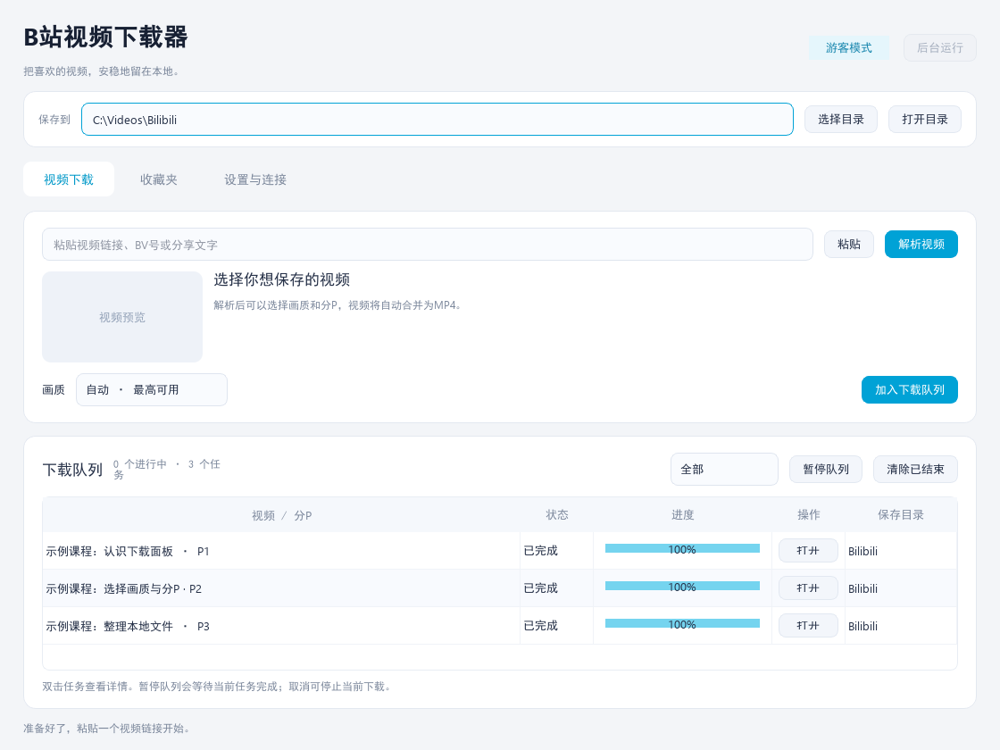
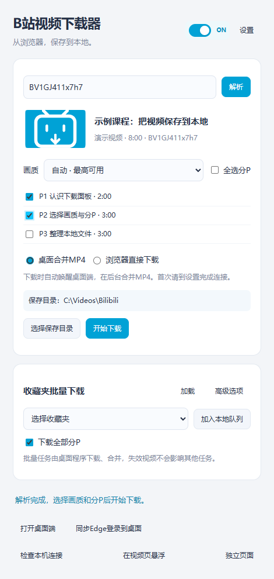

<div align="center">


# B站视频下载器

**在B站页面选好视频，交给桌面端自动下载、合并成MP4。**

Edge扩展负责视频页操作，Windows桌面端负责下载合并与后台队列。首次连接后，日常在浏览器里就能发起下载。

  

[让AI完成安装](#ai-install) · [开始使用（推荐）](#quick-start) · [单独使用桌面端](#desktop-only) · [完整使用说明](使用说明.md) · [获取源码与扩展](https://github.com/nekoFRE/bilibili-local-downloader/archive/refs/heads/main.zip)

</div>

<a id="ai-install"></a>
## 让AI完成安装

**不想手动配置？复制下面这句话，发给具备本机操作能力的AI助手：**

```text
请阅读 https://github.com/nekoFRE/bilibili-local-downloader 的安装说明，帮我在Windows电脑上完成桌面端环境准备、打包、Edge扩展安装及首次连接，保留已有数据，并在需要我手动操作时明确提示。
```

<table>
  <tr>
    <td width="70%" valign="top"></td>
    <td width="30%" valign="top"></td>
  </tr>
  <tr>
    <td><strong>桌面端</strong><br>下载、合并MP4与后台队列</td>
    <td><strong>Edge扩展</strong><br>选择视频、画质与分P</td>
  </tr>
</table>

<sub>真实桌面与扩展界面，使用演示任务和视频信息展示；不含用户账号或下载记录。点击图片可放大查看。</sub>

> **推荐用法：视频页选择 → 桌面端后台下载与合并 → MP4保存到自选目录。** 配置一次后，插件会按需唤醒桌面端，下载时无需一直显示桌面窗口。

## 你可以用它做什么

- **在视频页发起下载。** 点击「下载视频」打开悬浮面板，选好内容后交给桌面端；收起面板后可以继续浏览。
- **选好再下。** 支持画质选择、当前分P或多P下载，也能识别收藏夹列表中的视频地址。
- **收藏夹看清再选。** 封面卡片与紧凑列表随时切换，分批加载；按标题、UP主或BV号筛选，再勾选视频及分P。
- **保存带弹幕的视频。** 网页设置可作为默认参考，也能独立调整字号、透明度等并预览，生成弹幕版MP4。
- **保存成一个MP4。** 桌面端通过FFmpeg合并音视频，无需自己处理两个文件。
- **目录自己决定。** 桌面和插件共用保存目录，修改后自动同步；已排队任务保留原目录。
- **下载时再启动桌面。** 首次配置后，插件可以按需在后台唤醒下载器，通过系统托盘管理任务。

<a id="quick-start"></a>
<a id="desktop-and-edge"></a>
## 开始使用：桌面端 + Edge扩展（推荐）

可以使用顶部的[AI安装入口](#ai-install)，也可以按以下步骤手动安装：

1. **准备桌面端。** 使用你已有的完整发行版，或先按[源码打包指南](使用说明.md#build-source)生成发行版。打开 `发行版\B站视频下载器\B站视频下载器.exe`，选择保存目录。
2. **加载Edge扩展。** 在Edge地址栏输入 `edge://extensions`，开启「开发人员模式」，点击「加载解压缩的扩展」，选择发行版内的 **`edge-extension`** 文件夹。
3. **首次连接。** 桌面「设置与连接」→「复制连接码」；扩展「设置」→粘贴→「保存并检查连接」。看到「自动唤醒已配置」后，首次连接就完成了。
4. **在视频页下载。** 点击页面上的「下载视频」，选择「桌面合并MP4」、画质和分P，再点击「开始下载」。需要登录的内容，请先在同一个Edge配置中登录B站。

之后无需每次提前打开桌面端：提交任务时会自动后台启动，点击扩展中的「打开桌面端」可查看队列。移动发行版或扩展文件夹后，重新保存一次连接码即可。

> 当前GitHub仓库提供源码与扩展，尚未发布预编译Windows下载包。首次从GitHub获取完整桌面端，需要按[指南](使用说明.md#build-source)准备Python 3.13和FFmpeg并打包；已有完整发行版可直接运行EXE。

<a id="desktop-only"></a>
## 也可以单独使用桌面端

如果习惯复制链接，直接打开桌面端即可：

1. 在窗口顶部选择保存目录，粘贴视频链接、BV号或分享文字。
2. 点击「解析视频」，选择画质和分P，再点击「加入下载队列」。
3. 下载完成后点击任务的「打开」，即可播放合并后的MP4。

桌面版也支持收藏夹勾选、队列管理和托盘后台下载。需要登录时，可在设置中导入Cookie；也可通过Edge扩展同步一次登录。详细操作见[桌面使用说明](使用说明.md#desktop)。

### 按使用场景选择

| 使用方式 | 适合的场景 | 下载结果 |
| --- | --- | --- |
| **桌面端 + Edge扩展（推荐）** | 边看视频边下载，直接使用Edge登录状态 | 桌面后台下载并合并MP4 |
| **单独使用桌面端** | 复制链接下载、集中管理队列 | 自动合并MP4 |
| [浏览器直接下载（进阶）](#browser-only) | 想单独保存音视频轨道 | DASH音视频分别保存，不自动合并 |

## 收藏夹与后台下载

**收藏夹不必整夹下载。** 在Edge中登录B站，点击「收藏夹下载」→「浏览并选择」，选择收藏夹即显示第一批视频。两端都支持「卡片／列表」切换并记住偏好；滚动时分批读取，封面按需加载。

默认不勾选视频。「全选已加载」与「选择整个收藏夹」明确区分；搜索默认只筛选已加载的视频，需要完整范围时点击「搜索整个收藏夹」。可为单条视频选择分P，最后点击「加入下载队列（N）」。返回、筛选和切换显示方式均保留勾选。
打开「选择分P」时首次默认全不选；点击「应用选择」后记住该视频的选择，重启后仍可恢复。保存空选择不会回退成下载全部。
单P视频显示「单视频」，直接勾选即可；只有多P视频需要选择分P，数量未知时按需检查。

**关掉面板后，已提交任务继续下载。** 桌面窗口默认在最小化或关闭时收起到托盘；点击托盘图标恢复窗口，右键可暂停队列、打开目录或退出程序。完全退出会停止未完成任务；目前支持手动重试，尚无断点续传。

> 「暂停队列」会等待当前任务完成，再停止启动后续任务；要停止当前下载，请使用该任务的「取消」。

需要停止整批下载时，点击桌面下载队列或扩展主面板中的「全部取消」。当前下载和排队任务会取消，已完成文件保留；扩展也会取消本工具发起的浏览器下载。

## 带弹幕的MP4

在单视频或收藏夹的下载设置中开启「带弹幕」，点击「设置与预览」调节字号、不透明度、区域、速度及弹幕类型。更多设置提供字幕留白、密度、关键词过滤，以及额外保留普通视频或ASS弹幕文件。

**网页设置是只读参考；下载器中的修改只影响下载。** 默认采用可读取的网页设置，手动调整后自动切到「已自定义」。桌面端使用扩展最近传来的参考；未读取的项目明确采用默认值。每个任务在入队时固定配置。

弹幕版由桌面端重新编码生成，速度比普通合并慢，可能产生画质损失；弹幕写入画面后不能单独关闭。当前支持普通滚动、顶部、底部弹幕；智能防遮挡、BAS等特殊效果与HDR／杜比视界弹幕导出暂不支持。浏览器直下模式不生成弹幕版。详细说明见[弹幕设置](使用说明.md#danmaku)。

<a id="browser-only"></a>
<details>
<summary><strong>进阶选项：浏览器直接保存音视频轨道</strong></summary>

此选项适合需要分开保存音视频轨道的用户。**DASH视频会输出两个 `.m4s` 文件，需要后续合并才能得到完整MP4。** 日常下载完整视频，推荐使用上面的「桌面端 + Edge扩展」。

1. [下载源码ZIP](https://github.com/nekoFRE/bilibili-local-downloader/archive/refs/heads/main.zip)并解压到固定位置。
2. 在 `edge://extensions` 开启「开发人员模式」，点击「加载解压缩的扩展」，选择 **`edge-extension`** 文件夹。
3. 打开B站视频页，在下载面板中选择画质、分P和「浏览器直接下载」。

此模式无需桌面程序或连接码，默认通过Edge保存对话框选择位置。已有的音视频文件，可在桌面设置中用「合并已有音视频文件」生成MP4。

</details>

## 登录与本机数据

- **画质取决于账号权限。** 只提供当前账号和B站接口允许访问的内容与画质。
- **连接使用本机地址。** 扩展通过 `127.0.0.1:17890` 与桌面端通信，并用连接码验证请求。B站接口和媒体下载仍需要联网。
- **登录默认临时使用。** 扩展随任务传入的Cookie用于内存中的任务；连接时同步的登录默认也只在桌面端本次运行有效。
- **长期保存需要主动操作。** 在桌面设置中点击「保存当前登录」或导入Cookie后，使用Windows DPAPI加密保存到程序旁的 `data/login.dat`。
- **反馈时请隐藏隐私。** 不要在Issue、截图或公开仓库中附上Cookie、连接码、账号资料或个人下载历史。

## 常见问题

<details>
<summary><strong>下载了源码，为什么双击「启动下载器.bat」还不能用？</strong></summary>

启动脚本优先打开本地发行版，其次使用已准备好的 `.runtime` 环境。首次从GitHub下载源码时，请先[安装Python 3.13并打包](使用说明.md#build-source)。只想用浏览器下载，可以直接安装扩展。

</details>

<details>
<summary><strong>为什么下载后是两个.m4s文件？</strong></summary>

你选择了「浏览器直接下载」，而当前视频使用DASH格式。改用「桌面合并MP4」可自动合并；已有文件可在桌面设置中使用「合并已有音视频文件」。

</details>

<details>
<summary><strong>视频页没有按钮，或者悬浮窗打不开？</strong></summary>

检查插件总开关、悬浮窗开关及Edge对B站的站点访问权限。更新扩展后，在 `edge://extensions` 点击重新加载，再刷新视频页。页面中的操作栏按钮会等待B站初始化完成后出现，也可从工具栏弹窗点击「在视频页悬浮」。

</details>

<details>
<summary><strong>自动唤醒失败，需要重新安装吗？</strong></summary>

先手动打开完整发行版，确认同目录有 `browser-bridge.exe`；再到扩展设置点击「保存并检查连接」。更换程序位置、扩展安装位置或Edge配置后需要重新配置。完整排查见[使用说明](使用说明.md#troubleshooting)。

</details>

<details>
<summary><strong>修改保存目录后，为什么旧任务仍下载到原目录？</strong></summary>

任务在加入队列时记住目录。新的目录只影响之后加入的任务，避免正在下载的文件被突然移动。插件面板在目录可见且桌面端运行时会自动同步显示，通常约2秒；也可在扩展设置点击「同步桌面目录」。

</details>

<details>
<summary><strong>支持哪些系统？是否需要一直打开桌面窗口？</strong></summary>

当前面向Windows，已有Windows 11验证记录；macOS和Linux尚未适配。下载时桌面端可以收起到托盘，窗口不必一直显示；从托盘菜单完全退出程序会停止未完成任务。

</details>

## 源码与反馈

项目保留少量Python模块和原生JavaScript扩展，便于阅读、修改和本地打包。

| 位置 | 内容 |
| --- | --- |
| `main.py`、`ui.py` | 桌面入口、窗口与托盘 |
| `downloader.py`、`tasks.py` | 视频解析、下载合并、任务队列与本机接口 |
| `danmaku.py` | 弹幕设置、分段数据读取与ASS排布 |
| `browser_bridge.py` | Edge按需唤醒助手 |
| `edge-extension/` | Manifest V3浏览器扩展 |
| `打包.bat`、`打包.ps1` | 生成完整Windows发行版 |

[完整使用说明](使用说明.md) · [版本更新记录](更新记录.md) · [提交问题或建议](https://github.com/nekoFRE/bilibili-local-downloader/issues/new)

反馈时提供：Windows与Edge版本、插件版本、操作步骤、预期结果和实际结果。可以附去除隐私的截图；如问题与特定视频有关，提供公开的视频链接即可。

界面使用[PySide6](https://doc.qt.io/qtforpython-6/)，音视频合并使用[FFmpeg](https://ffmpeg.org/)。FFmpeg随附的许可证见[tools/FFmpeg-LICENSE.txt](tools/FFmpeg-LICENSE.txt)。
